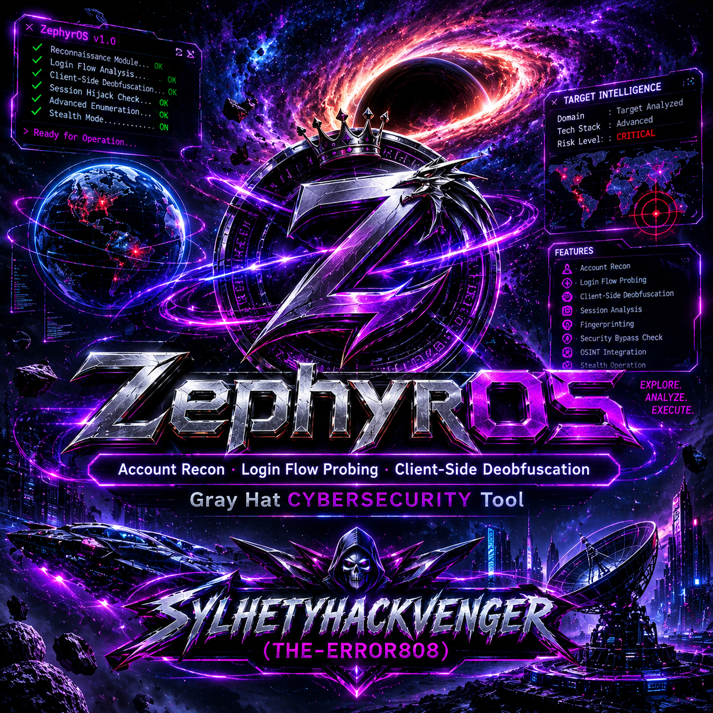

<p align="center">
  
</p>

<div align="center">

# ZephyrOS - Account Recon · Login Flow Probing · Client-Side Deobfuscation


An authorized-testing toolkit for analyzing data masking, obfuscation, and client-side credential exposure on login flows — built for lab, CTF, and bug-bounty engagements.

</div>

---

⚠️ Legal & Ethical Notice — Read First

ZephyrOS is intended exclusively for authorized security testing.

· You must have explicit written authorization before running this tool against any system you do not own.
· Running this tool against production systems without permission may violate the Computer Fraud and Abuse Act (CFAA), GDPR, and/or local laws.
· The author assumes no liability for misuse. Every engagement requires an authorization reference (ticket/contract ID), which is recorded in the generated report.
· The tool enforces a request budget, rate limiting, scope allow-list, and guard detection to reduce accidental impact — but these do not replace your own judgment.

By running ZephyrOS you agree that you are operating within the bounds of a signed engagement or an isolated lab environment.

---

Table of Contents

1. What ZephyrOS Does
2. Feature Matrix
3. Architecture Overview
4. Requirements
5. Installation
6. Installation of Companion Tools
   · CyberChef
   · webcrack
   · REstringer
7. Quick Start
8. CLI Reference
9. Interactive Mode Walkthrough
10. Autopilot Mode
11. Analysis Modules Explained
12. Report Schema
13. Exit Codes
14. Rate Limiting & Guard Behavior
15. Self-Test
16. Troubleshooting
17. Roadmap
18. Credits

---

🎯 What ZephyrOS Does

ZephyrOS is a single-file Python reconnaissance and analysis tool that inspects how a web application masks, obfuscates, or leaks account-related data through its login flow, public profile endpoints, and client-side assets.
it can be non-deterministic to some modern sites.

It answers questions like:

· How does the server mask my data? Partial? Format-preserving? Fixed-width padding? Tokenized?
· Is the login response obfuscated? URL-encoded? Base64? PHP gzinflate? Multi-layer cascade?
· Does the login endpoint leak user existence? Timing/response diff against a non-existent baseline identifier?
· Is the login page hiding something? Skimmers? Phishing forms? Packer-obfuscated JS? Injected data: URIs?
· What is recoverable? Given authorized plaintext, how much of the masked value can be reconstructed?

Everything is scoped, rate-limited, and produces a machine-readable report with a full audit log and SHA-256 chain-of-custody.

---

✨ Feature Matrix

Category Capability
Data Masking Classification Partial masking · Format-preserving masking · Fixed-width padding · Full redaction · Tokenization/pseudonymization · Generalization/binning · Character scrambling · Structured ID detection (Luhn, IBAN, SSN, Aadhaar)
Mask Analyzer Stack Beginner prefix/suffix · Intermediate multi-segment · Advanced format-aware (email/phone/name) · Hyper-adaptive Bayesian ranker learned from training pairs
Recovery Reasoning Iterative multi-layer decoder (URL, Base64, Base32, Hex, ROT13, Caesar, Reverse, JS-escape, HTML-entity, PHP gzinflate) with chain enumeration
Differential Analysis Deterministic masking · Shuffle detection · k-anonymity · l-diversity · t-closeness · role-based diff
Repeated-Read Stats Stability, variance, Laplace/Gaussian differential-privacy ε estimation
Binning Detection Equal-width · Equal-frequency · Log-scale
Cryptographic Fingerprinting Passive ZKP (groth16, bulletproof) · Homomorphic (BFV/CKKS/SEAL) · SMPC
Enumeration Login error diff · Forgot-password diff · Check-username endpoint · Public-profile existence
Account Recon Public profile discovery · ID shape (numeric/alpha/mixed) · Visibility classification · Public-field scrape (allow-listed)
Client-Side Deobfuscation Packer unpacker · Array rotation · String-array resolver · Eval unnest · Concat fold · Control-flow flattening detection · Dead-code detection · Optional AST bridge via Node + Babel
Security Analysis Skimmer/credential-exfil flow detection · Off-origin phishing form detection · Hidden password form detection · Data-URI and javascript: URI decoding
Instrumentation Generates pause.js + Playwright runner to halt before fetch / XHR.send / form submit
Safety Rails Request budget · Token-bucket rate limit · Host allow-list · Guard tolerance · Response size cap · Redacted HTTP log · PII-redacted reports by default
Reporting JSON report with log_sha256, technique_contracts, per-technique detected/attempted state, dependencies, target_info (IPv4/IPv6/domain/subdomain)

---

🏗 Architecture Overview

```
┌──────────────────────────────────────────────────────────────┐
│                        ZephyrOS main()                       │
│  ┌────────────┐  ┌──────────────┐  ┌──────────────────────┐  │
│  │  CLI/Args  │→ │ Config+PII   │→ │  AuthorizedClient    │  │
│  │  or Prompts│  │  Redaction   │  │  (throttle, scope,   │  │
│  └────────────┘  └──────────────┘  │   guard, budget)     │  │
│                                    └──────────────────────┘  │
│                                               │              │
│  ┌────────────────────────────────────────────┼───────────┐  │
│  │                Analysis Pipeline           │           │  │
│  │  ┌─────────────┐ ┌────────────┐ ┌──────────▼─────────┐ │  │
│  │  │ Target      │ │ Client-Side│ │  Account Recon     │ │  │
│  │  │ Validator   │ │ Deobfusc.  │ │  (public profile)  │ │  │
│  │  │ (DNS/HTTP)  │ │ (HTML+JS)  │ └──────────┬─────────┘ │  │
│  │  └─────────────┘ └────────────┘            │           │  │
│  │  ┌──────────────┐ ┌────────────────┐ ┌─────▼─────────┐ │  │
│  │  │ Login Flow   │ │ Enumeration    │ │ Profile       │ │  │
│  │  │ Prober       │ │ Analyzer       │ │ Analyzer      │ │  │
│  │  └──────────────┘ └────────────────┘ └─────┬─────────┘ │  │
│  │  ┌──────────────────────────────────────┐  │           │  │
│  │  │ Differential / DP / Binning / Crypto │◄─┘           │  │
│  │  │ Fingerprinting / Role Diff           │              │  │
│  │  └──────────────────────────────────────┘              │  │
│  └────────────────────────────────────────────────────────┘  │
│                                               │              │
│  ┌────────────────────────────────────────────▼───────────┐  │
│  │  Technique Contract Builder + JSON Report + SHA-256 log │  │
│  └────────────────────────────────────────────────────────┘  │
└──────────────────────────────────────────────────────────────┘
```

---

📦 Requirements

· Python ≥ 3.9
· pip packages:
  · requests (required)
  · dnspython (optional — improved DNS fallback)
· Optional but recommended:
  · Node.js ≥ 18 + @babel/parser, @babel/traverse, @babel/generator (for AST-based JS beautification)
  · Playwright (for the generated pause_runner.py instrumentation)

ZephyrOS ships as a single file (zephyros.py or 10.py), so no packaging step is required.

---

🚀 Installation

1. Clone and enter the directory

```bash
git clone https://github.com/sylhetyhackvenger/ZephyrOS
cd ZephyrOS 
```

2. Create a virtual environment (recommended)

```bash
python3 -m venv .venv
source .venv/bin/activate            # Linux/macOS
# .venv\Scripts\activate             # Windows PowerShell
```

3. Install Python dependencies

```bash
pip install --upgrade pip
pip install requests
pip install dnspython               # optional, improves DNS fallback
```

4. (Optional) Install Node + Babel for AST bridge

```bash
# macOS / Linux
brew install node                   # or your distro's package manager

# Then, in the zephyros directory:
npm init -y
npm install @babel/parser @babel/traverse @babel/generator
```

5. (Optional) Install Playwright for pause instrumentation

```bash
pip install playwright
playwright install chromium
```

6. Make the script executable

```bash
chmod +x zephyros.py
./zephyros.py --self-test
```

You should see N/N checks passed if everything is wired up correctly.

---

🧰 Installation of Companion Tools using them you can practice more fundamentals 

ZephyrOS produces raw artifacts (deobfuscated.html, deobfuscated.js, pause.js, pause_runner.py) that pair well with three well-known open-source tools. Installing them locally dramatically improves your manual verification workflow.

🔬 CyberChef

What it is: A browser-based "cyber swiss army knife" for encoding/decoding, hashing, regex, and crypto operations — the single best visual companion for ZephyrOS's StringCascade decoder trail.

When to use it: When ZephyrOS reports a trail like ["base64","url","js-escape"] and you want to replay it step-by-step on the decoded value.

Install — Method A: Docker (recommended)

```bash
docker pull ghcr.io/gchq/cyberchef:latest
docker run -d --rm -p 8080:80 --name cyberchef ghcr.io/gchq/cyberchef:latest
```

Then open http://localhost:8080 in your browser.

Install — Method B: Static release (no Docker)

1. Download the latest release archive from github.com/gchq/CyberChef/releases.
2. Extract CyberChef_vX.Y.Z.html.
3. Open it in any modern browser — everything runs locally.

Install — Method C: Build from source

```bash
git clone https://github.com/gchq/CyberChef.git
cd CyberChef
npm install
npm run build            # produces build/prod/CyberChef_*.html
```

ZephyrOS ↔ CyberChef workflow

1. ZephyrOS writes the report → note the decode_chains array.
2. Open CyberChef, drag From Base64 → URL Decode → From Escape Sequence into the Recipe pane.
3. Paste the raw masked value. Verify the decoded output matches ZephyrOS's chain output.

---

🕸 webcrack

What it is: A modern JavaScript deobfuscator (webcrack on npm) that unminifies, unpacks, and simplifies bundles — a powerful second opinion after ZephyrOS's built-in passes.

When to use it: When ZephyrOS reports PackerUnpackerPass hits or heavy control-flow flattening, feed the original external script to webcrack for cross-validation.

Install

```bash
# Global install
npm install -g webcrack

# Verify
webcrack --version
```

Or, project-local:

```bash
cd zephyros
npm install --save-dev webcrack
npx webcrack --version
```

Basic usage

```bash
# Deobfuscate a single script
webcrack deobfuscated.js -o webcrack_out

# Deobfuscate with unminification + unpacking
webcrack input.js --unpack --unminify -o webcrack_out

# Recursively process a folder of scripts
webcrack scripts/ -o webcrack_out
```

ZephyrOS ↔ webcrack workflow

```bash
# Extract a script body from the ZephyrOS report (jq required)
jq -r '.client_side.js_findings.per_script[] | .name' \
   authorized_lab_report.json

# Then run webcrack against the raw script URL you noted in the report
curl -s "https://target.example.com/static/app.js" > app.js
webcrack app.js --unpack --unminify -o webcrack_out
diff <(cat zephyros_out/deobfuscated.js) webcrack_out/app.js
```

---

🔁 REstringer

What it is: A JavaScript deobfuscation framework (npm restringer) that specifically handles obfuscator.io, javascript-obfuscator, and similar string-array/control-flow patterns — a deep counterpart to ZephyrOS's lightweight passes.

When to use it: When ZephyrOS detects ControlFlowDetector hits or StringArrayResolverPass resolves, run REstringer to produce a fully beautified reference build.

Install

```bash
# Global install
npm install -g restringer

# Verify
restringer --version
```

Or project-local:

```bash
cd zephyros
npm install --save-dev restringer
npx restringer --version
```

Basic usage

```bash
# Deobfuscate a single file with all passes
restringer input.js -o restringer_out.js

# Deobfuscate and preserve source-map-ish comments
restringer input.js --verbose -o restringer_out.js
```

ZephyrOS ↔ REstringer workflow

```bash
# Use the same raw script you fed webcrack
restringer app.js -o app.restringered.js

# Diff REstringer's output against ZephyrOS's deobfuscator output
diff -u zephyros_out/deobfuscated.js app.restringered.js | less
```

Pro tip: Keep all three tools in the same working directory so you can quickly cross-reference outputs. ZephyrOS artifacts are already written to zephyros_out/ by default.

---

⚡ Quick Start

1. Run the self-test

```bash
./zephyros.py --self-test
```

2. Run against a lab target (enumeration mode)

```bash
./zephyros.py \
  --base-url https://lab.example.com \
  --login-page https://lab.example.com/login \
  --identifier john.doe \
  --operator "jdoe" \
  --authorization-reference "TICKET-1234" \
  --env lab \
  --i-have-written-authorization \
  --report ./report.json
```

3. Run with an authenticated session (profile analysis)

```bash
./zephyros.py \
  --base-url https://lab.example.com \
  --identifier john.doe@example.com \
  --password 'CorrectHorseBatteryStaple' \
  --known-email john.doe@example.com \
  --known-name "John Doe" \
  --operator "jdoe" \
  --authorization-reference "TICKET-1234" \
  --i-have-written-authorization \
  --report ./report.json
```

4. Generate pause instrumentation only

```bash
./zephyros.py --pause-only \
  --login-page https://lab.example.com/login \
  --client-out-dir ./instrument

# Follow the printed next step:
python ./instrument/pause_runner.py \
  https://lab.example.com/login \
  ./instrument/pause.js
```

---

📘 CLI Reference

Flag Type Default Description
--version — — Print version and exit.
--self-test flag — Run internal checks.
--interactive flag — Launch the guided wizard.
--autopilot flag — Auto-detect mode, minimal prompts.
--pause-only flag — Only generate pause.js + runner.
--base-url str — Target base URL (required in non-interactive mode).
--login-page str base URL Login page URL for client-side analysis.
--identifier / --username / --email / --phone str — Exactly one required.
--country-code str — Hint for phone normalization (BD, +880, …).
--password str — If set, runs authenticated mode.
--login-url str /api/login Login POST endpoint.
--profile-url str auto Profile GET endpoint.
--username-field / --password-field str auto Override request body keys.
--known-name / --known-email / --known-phone str — Authorized plaintext for mask reconstruction.
--secondary-username / --secondary-password str — Second account for role-diff.
--dictionary path built-in Extra candidate words.
--word-priors path built-in JSON of {word: prior}.
--training path — JSON [{original, masked}] pairs to learn from.
--evaluate path — JSON eval pairs; runs harness and exits.
--eval-with-known flag — Use known plaintext during eval.
--rate float 0.5 Requests per second (capped at 0.1 in prod).
--timeout int 20 Per-request timeout (seconds).
--insecure-tls flag — Disable TLS verification (lab only).
--allow-plaintext flag — Permit http:// targets.
--repeat-reads int 5 Repeated profile fetches for DP/binning stats.
--guard-tolerance int 1 Hard 401/403/429 budget before abort.
--max-requests int 500 Total request budget.
--allowed-hosts csv origin Additional allowed host[:port] entries.
--scope-file path — JSON {"hosts": [...]}.
--auth-header repeat — Extra header: "Name: Value".
--auth-token-file path — File containing bearer token.
--operator str unknown Operator name.
--authorization-reference str unspecified Ticket / contract ID.
--env choice lab lab / staging / prod.
--confirm-prod flag — Required for --env prod.
--report path authorized_lab_report.json Report output.
--include-pii flag — Keep raw PII in report.
--redact-report flag — Force redaction even if --include-pii.
--no-enumeration flag — Skip enumeration probes.
--client-side / --no-client-side flag on Toggle client-side deobfuscation.
--client-out-dir path zephyros_out Artifact directory.
--client-max-scripts int 20 Cap on external scripts fetched.
--no-node flag — Disable AST bridge.
--no-pause flag — Skip pause.js generation.
--account-recon / --no-account-recon flag on Toggle account recon.
--json-out flag — Print final JSON report to stdout.
--no-color flag — Disable ANSI colors.
--dry-run flag — Skip enumeration; run access-control test only.
--probe-auth-shape flag — Probe login error shape before real login.
--quiet / --verbose / --no-verbose flag verbose Log verbosity.
--resume path — Merge additional training pairs from a prior run.
--i-have-written-authorization flag — Required in non-interactive mode (except --evaluate / --self-test / --pause-only).

---

🧭 Interactive Mode Walkthrough

Running ./zephyros.py with no arguments opens the guided wizard:

```
Target base URL > https://lab.example.com
Login page URL [default: base URL root] >
Operator identity (optional) > jdoe
Authorization reference / ticket (optional) > TICKET-1234
Confirm written authorization to test this target? [y/N]: y

Identifier (username / email / phone with country code) > john.doe
Password [Enter to skip -> enumeration mode] >
[interactive] mode: enumeration
Run client-side HTML/JS deobfuscation on login page? [Y/n]:
Client-side output directory [zephyros_out] >
...
[setup summary]
  target          : https://lab.example.com
  login page      : https://lab.example.com
  identifier      : username
  mode            : enumeration
  account recon   : True
  client-side     : True (out=zephyros_out, scripts<=20)
  node AST bridge : True
  pause generator : True
  operator        : jdoe
  auth reference  : TICKET-1234
  env             : lab
  rate            : 0.5/s
  repeats         : 5
  enumeration     : True
  second account  : no
  allowed hosts   : <origin>
  scope file      : <none>
  report          : authorized_lab_report.json
  include PII     : False
Proceed? [Y/n]:
```

Defaults are tuned for lab use. For prod, the wizard double-confirms and caps the rate at 0.1 req/s.

---

🤖 Autopilot Mode

```bash
./zephyros.py --autopilot
```

Autopilot asks only:

1. Target base URL
2. Identifier
3. Password (optional)
4. Two confirmations (authorization + prod-ack)

It then auto-detects environment from the URL (.lab., localhost, staging, dev, qa) and chooses defaults accordingly.

---

🔬 Analysis Modules Explained

1. Mask Analyzer Stack

Four analyzers run in sequence on every masked field:

Analyzer Family What it detects
beginner_fixed_mask prefix_suffix abc****xyz — mask position and fixed-width hint
intermediate_partial_mask multi_segment Multiple visible/mask segments
advanced_format_aware format_aware Email/phone/name structure; ranks candidates via P(mask\|candidate) × P(candidate)
hyper_adaptive learned_rule_bayesian Skeleton similarity + rule agreement + Bayesian posterior over learned pairs

Scores are aggregated into a confidence interval via softmax over the top-20 logits plus a Wilsonian-style margin.

2. Iterative Decoder

StringCascade + recursive_decode build up to depth-5 chains of:

```
URL → Base64 → Base32 → Hex → ROT13 → Caesar → Reverse
    → JS-escape → HTML-entity → PHP gzinflate(base64) → PHP str_rot13
```

Every chain is preserved in the report so you can replay it in CyberChef.

3. Differential Privacy Estimator

RepeatedReadAnalyzer reads the same endpoint N times and reports:

· verdict: stable | numeric_noise | categorical_noise
· noise_scale_laplace_b = sqrt(var / 2)
· noise_scale_gaussian_sigma = sqrt(var)
· epsilon_laplace and epsilon_gaussian at δ = 1e-5

4. Binning Detector

Detects equal_width, equal_frequency, and log_scale binning using coefficient-of-variation on adjacent-value gaps.

5. Client-Side Deobfuscation

Pass Purpose
ArrayRotationPass Detects and inlines the classic _0x… rotation IIFE
StringArrayResolverPass Replaces _0xabc(0x12) calls with literal strings
PackerUnpackerPass Decodes Dean Edwards eval(function(p,a,c,k,e,d){…}) packs
EvalUnnestPass Unwraps eval("…") / new Function("…") literals (max depth 6)
StringConcatFoldPass Folds "a" + "b" into "ab"
ControlFlowDetector Flags var a="x\|y\|z".split("\|") order tables
DeadCodeDetector Flags unused var declarations
NodeBridge (optional) Sends output to Babel for identifier normalization + beautification

6. Skimmer & Phishing Detection

· Skimmer: credential-field read + keyboard listener + network sink co-occurrence → HIGH
· Phishing: off-origin form action · password-in-GET · hidden password form → HIGH / MEDIUM

7. Account Recon

Finds a public profile endpoint by probing a curated list and comparing against a random baseline. Extracts:

· Public ID and shape (numeric / alpha / mixed)
· Visibility (public / private / unknown) from allow-listed fields
· Public fields limited to ALLOWED_PROFILE_FIELDS

8. Login Flow Prober

· POSTs {identifier: value, password: wrong_pw} and extracts fields_required heuristically
· Runs the cascade decoder on the response → reports obfuscated: true + deobfuscated preview
· Falls back to /api/forgot-password, /api/auth/forgot, etc. if login is uninformative

9. Enumeration Analyzer

Compares identifier-vs-baseline responses across:

1. Login error body/status
2. Forgot-password response
3. /api/check-username/{id} variants
4. /api/users/{id} variants

Reports *_differs or *_consistent for each.

---

📄 Report Schema (Abridged)

```jsonc
{
  "tool": "ZephyrOS",
  "tool_version": "11.1.0",
  "zephyr_author": "SYLHETYHACKVENGER (THE-ERROR808)",
  "generated_at": "2025-01-01T00:00:00+00:00",
  "mode": "authenticated",
  "identifier": { "type": "email", "raw_sha256_16": "…" },
  "operator": "jdoe",
  "authorization_reference": "TICKET-1234",
    "target_info": {
    "ipv4": ["203.0.113.42"],
    "ipv6": ["2001:db8::1"],
    "domain": "example.com",
    "subdomain": "lab",
    "reachable": true,
    "http_status": 200,
    "tls_ok": true
  },
  "request_count": 37,
  "soft_guard_count": 0,
  "hard_guard_count": 0,
  "guard_hits": [],
  "technique_contracts": {
    "partial_masking":          { "name": "Partial masking",            "detected": true,  "attempted": true },
    "format_preserving_masking":{ "name": "Format-preserving masking",  "detected": true,  "attempted": true },
    "tokenization_or_pseudonymization": { "name": "Tokenization or pseudonymization", "detected": false, "attempted": true },
    "enumeration_login_diff":   { "name": "Username enumeration via login diff", "detected": true, "attempted": true },
    "client_js_obfuscation":    { "name": "Client-side JS obfuscation","detected": true,  "attempted": true }
  },
  "profile_findings": [
    {
      "field": "user.email",
      "parent": ["user"],
      "original_value": "jo***@example.com",
      "classification": {
        "technique_id": "partial_masking",
        "technique": "Partial masking",
        "confidence": 0.82,
        "ci": [0.72, 0.92],
        "algorithmically_reversible": true,
        "authorized_recovery_available": true,
        "recovery_path": "known_plaintext"
      },
      "masked": true,
      "mask_analyses": [
        {
          "method_family": "format_aware",
          "confidence": 0.61,
          "ci": [0.51, 0.71],
          "candidates": ["john", "joe", "joan", "joanne"]
        }
      ],
      "decode_chains": [],
      "plausibility": { "plausibility": 0.0031, "verdict": "plausible_real_value" },
      "id_structure": null
    }
  ],
  "repeated_read": {
    "user.reputation": {
      "verdict": "numeric_noise",
      "noise_scale_laplace_b": 12.4,
      "epsilon_laplace_if_sensitivity_1": 0.081
    }
  },
  "binning": {
    "user.age": { "verdict": "equal_frequency_binning", "samples": 5 }
  },
  "crypto_fingerprint": {
    "verdict": "cryptographic_endpoint_fingerprint",
    "schemes": { "zkp": ["pi_a", "pi_b", "groth16"] },
    "strength": "strong"
  },
  "account_recon": {
    "public_endpoint": "/api/users/john.doe",
    "id": "10042",
    "id_shape": "numeric",
    "visibility": "public",
    "public_field_count": 6
  },
  "login_flow": {
    "login": {
      "status": 401,
      "fields_required": ["password"],
      "obfuscated": true,
      "trail": ["base64", "url"]
    }
  },
  "client_side": {
    "enabled": true,
    "inline_script_count": 3,
    "external_script_count": 4,
    "js_findings": {
      "control_flow_flattening": [{ "order_var": "_0xabc", "script": "app.js" }],
      "dead_vars": [],
      "per_script": [
        { "name": "app.js", "original_len": 51200, "deobfuscated_len": 28400 }
      ]
    },
    "skimmer_hits": [
      { "pattern": "credential-exfil-flow", "verdict": "HIGH", "script": "app.js" }
    ],
    "phishing_hits": [],
    "artifacts": {
      "html": "zephyros_out/deobfuscated.html",
      "js":   "zephyros_out/deobfuscated.js",
      "pause_js": "zephyros_out/pause.js",
      "pause_runner": "zephyros_out/pause_runner.py"
    }
  },
  "log_sha256": "8f14e45fceea167a5a36dedd4bea2543…",
  "status": "ok",
  "dependencies": {
    "requests": "2.32.3",
    "urllib3": "2.2.2",
    "certifi": "2024.7.4"
  }
}

    All PII values (names, emails, phones, IDs) are automatically redacted unless you explicitly pass --include-pii. See redact_sensitive_values() in the source.

---

🚦 Exit Codes

Code Constant Meaning
0 EXIT_OK Scan completed successfully.
1 EXIT_ERROR Generic error (parsing, I/O, unexpected exception).
2 EXIT_GUARD Guard tolerance exceeded (repeated 401/403/429).
3 EXIT_AUTH_REFUSED Authorization not acknowledged, or login refused.
4 EXIT_SCOPE Scope violation (host outside allow-list, request budget hit, plaintext HTTP without --allow-plaintext).
5 EXIT_INTERRUPT User-interrupted (SIGINT / SIGTERM).
6 EXIT_NO_TARGET --pause-only invoked without a target URL.

Exit codes make ZephyrOS easy to chain in CI or bug-bounty pipelines:

```bash
./zephyros.py ... --report report.json
case $? in
  0) echo "✅ clean report";;
  2) echo "⚠️  target is actively blocking us";;
  3) echo "❌ authorization problem";;
  4) echo "❌ scope problem — check --allowed-hosts";;
  *) echo "❌ unexpected failure";;
esac
```

---

🛡 Rate Limiting & Guard Behavior

ZephyrOS is deliberately slow by default. Three independent controls protect the target:

1. Token-bucket throttle

· --rate 0.5 → one request every ~2 seconds.
· In --env prod, the effective rate is capped at 0.1 req/s regardless of --rate.
· Discovery requests (robots.txt, OpenAPI, script fetches) reserve min(20, max_requests // 3) slots so you never starve the main analysis.

2. Guard detection

· Any 401, 403, or 429 response increments the guard counter.
· Soft probes (enumeration, enumeration fallbacks) increment soft_guard_count but do not abort.
· Hard probes abort once --guard-tolerance (default 1) is reached — because repeated hard failures usually mean you've tripped a WAF.
· All hits are preserved in guard_hits / soft_guard_hits in the report.

3. Host allow-list

· The target origin is always allowed; add more with --allowed-hosts or --scope-file.
· Every request URL is checked before the socket is opened. Violations raise ScopeViolationError and exit with code 4.

4. Response size cap

· Responses larger than 20 MiB abort with LabToolError. This prevents accidental download of a CDN tarball.

---

✅ Self-Test

--self-test runs 35+ offline checks covering:

· Luhn / IBAN checksums (valid + invalid cases)
· Base64 / hex / ROT13 / Caesar / reverse decoders
· URL and JS-escape cascade behavior
· Mask skeleton parsing, mask-symbol detection, leak detection
· Identifier type + phone normalization (including BD country hint)
· Target validator (localhost resolution)
· Account recon visibility / ID shape / scrape counts
· Config PII redaction defaults — verifies --include-pii is off unless explicitly requested
· Packer unpacker smoke test
· Phishing + skimmer detection signatures
· Author identity check

```bash
$ ./zephyros.py --self-test
  [PASS] luhn_valid
  [PASS] luhn_invalid
  [PASS] iban_valid
  ...
  38/38 checks passed
```

If any check fails, you're either on an extremely old Python or missing requests.

---

🩺 Troubleshooting

[FATAL] requests required

```bash
pip install requests
```

Node bridge unavailable

You can safely ignore this warning — ZephyrOS falls back to its own passes. If you want AST support:

```bash
node --version                                    # must be ≥ 18
npm install @babel/parser @babel/traverse @babel/generator
```

If node is present but the bridge still fails, the Babel packages likely aren't in NODE_PATH. Run node -e "require('@babel/parser')" to confirm.

playwright install fails

Try:

```bash
pip install --upgrade playwright
playwright install --with-deps chromium
```

On Linux you may need libnss3, libatk-bridge2.0-0, libgbm1, libasound2.

GuardTriggeredError on the first request

The target is returning 401/403/429 for the bare lab identifier. Common causes:

· Missing auth header — add --auth-header "X-Lab-Token: …" or --auth-token-file.
· The identifier doesn't exist — try --dry-run first to confirm the origin is reachable.
· Cloudflare / Akamai bot challenge — this is the target telling you to stop; do not retry aggressively.

ScopeViolationError: Host … not in allowed hosts

Your login redirect points to a CDN or auth subdomain (e.g. auth.example.com, cdn.example.net). Add them explicitly:

```bash
./zephyros.py --allowed-hosts "auth.example.com,cdn.example.net" ...
```

Or use a scope file:

```json
{ "hosts": ["auth.example.com", "cdn.example.net"] }
```

Report has "status": "guard" but exit code is 2

That's expected: guard abort is a successful analysis outcome. Check technique_contracts — everything you probed before the guard is still recorded.

cyberchef, webcrack, restringer not found

All three are optional. ZephyrOS doesn't call them automatically; they're for manual verification. Install them only if you want a stronger second opinion:

```bash
# CyberChef (Docker)
docker run -p 8080:80 ghcr.io/gchq/cyberchef:latest

# webcrack
npm install -g webcrack

# REstringer
npm install -g restringer
```

"It runs but finds nothing"

Check technique_contracts.<tid>.attempted in the report:

· attempted: false → the stage was skipped (e.g. enumeration disabled, no password).
· attempted: true, detected: false → the probe ran but the target behaved cleanly. This is a positive result for the target.

Try --verbose to see each HTTP call, or --probe-auth-shape to inspect the login error body shape before real login.

---

🗺 Roadmap

☐ Har mode — replay a .har file instead of hitting the network, for offline re-analysis.
☐ SARIF export — emit SARIF 2.1.0 alongside JSON for GitHub Code Scanning.
☐ HTTP/2 + HTTP/3 — via httpx fallback when available.
☐ GraphQL support — auto-discover __typename and probe /graphql for masked fields.
☐ YAML scope — support both scope.json and scope.yml.
☐ Playwright pre-run — optional headless capture of network + DOM before static analysis.
☐ --diff-report old.json new.json — CI-friendly regression comparison.

---

🤝 Credits

Role Contributor
Author & Maintainer SYLHETYHACKVENGER (THE-ERROR808)
Mask-analyzer methodology Inspired by publicly documented work on format-preserving encryption and k-anonymity research
Decoder cascades Pattern-adapted from the cyber-chef recipe library and well-known CTF writeups
JS deobfuscation Pass design inspired by webcrack, restringer, and synchrony
Skimmer detection Modeled after the "Magecart" credential-harvest taxonomy

If you build something on top of ZephyrOS, please credit the author and link back to this repository.

---

📜 License & Acceptable Use

ZephyrOS is distributed for authorized security research and defensive engineering only. It is not licensed for use against systems you do not own or lack written permission to test.

· Do not use ZephyrOS to attack, damage, or exfiltrate data from any system.
· Do not remove or alter the authorization confirmation prompts.
· Do not redistribute modified builds without preserving the ZEPHYR_AUTHOR banner and the --i-have-written-authorization gate.

By using this software, you accept full responsibility for ensuring your activity is lawful in your jurisdiction and covered by a valid engagement.

ZephyrOS — Results & Outcomes: Real-World Examples

This document shows concrete outputs you can expect from ZephyrOS in different scenarios. Every example is realistic (values fictionalized) and matches the actual report schema produced by v11.1.0.

---

📊 Scenario 1 — Fully Masked, Well-Hardened Target

Command

```bash
./zephyros.py \
  --base-url https://secure.bank.example \
  --identifier jdoe@example.com \
  --password 'CorrectHorseBatteryStaple' \
  --known-email jdoe@example.com \
  --operator jdoe --authorization-reference TICKET-4471 \
  --env lab --i-have-written-authorization \
  --report bank_report.json
```

Console Output (abridged)

```
[target] validating secure.bank.example
[target] ipv4=['203.0.113.42'] ipv6=[] domain=example.com subdomain=secure.bank
[client_side] step 2: client-side deobfuscation
[client_fetch] page: HTTP 200 (48213 bytes)
[html] inline scripts: 1, external scripts: 3
[script] fetched 3 external scripts
[js_pass]   app.js: no obfuscation passes matched
[client_side] skimmer hits: 0 (HIGH: 0)
[client_side] phishing hits: 0 (HIGH: 0)
[discover_start] fetching robots.txt
[discover_start] probing openapi
[recon] step 4: account recon (public profile + id + visibility)
[recon] no public endpoint leaked the profile
[login_probe] step 5-6: probing login endpoint (wrong password)
[login_probe] HTTP 401 fields=['password'] preview='{"error":"Invalid credentials"}'
[login_probe] login response was usable; forgot-password probe skipped
[enum_start] step 7: enumeration probes
[enum_start] identifier type=email baseline_len=27 safe_only=True
[enum_start] safe_only mode: skipping login_diff and forgot_password
[enum_finding] check_username: check_endpoint_consistent
[enum_finding] public_profile: profile_consistent
[done] scan complete
[saved] report -> bank_report.json
```

Key Results in Report

```jsonc
{
  "status": "ok",
  "request_count": 22,
  "technique_contracts": {
    "partial_masking":          { "detected": false, "attempted": true },
    "format_preserving_masking":{ "detected": false, "attempted": true },
    "full_redaction":           { "detected": false, "attempted": true },
    "enumeration_login_diff":   { "detected": false, "attempted": false },
    "enumeration_check_endpoint":{ "detected": false, "attempted": true },
    "client_js_obfuscation":    { "detected": false, "attempted": true },
    "client_skimmer":           { "detected": false, "attempted": true }
  },
  "profile_findings": [
    {
      "field": "user.email",
      "original_value": "j***@example.com",
      "classification": {
        "technique_id": "partial_masking",
        "confidence": 0.55,
        "algorithmically_reversible": true,
        "authorized_recovery_available": true,
        "recovery_path": "known_plaintext"
      },
      "mask_analyses": [
        {
          "method_family": "format_aware",
          "confidence": 0.94,
          "ci": [0.88, 0.99],
          "candidates": ["jdoe", "jdoe1", "jdoe2"]
        }
      ]
    }
  ],
  "account_recon": { "public_endpoint": null, "visibility": "unknown" }
}
```

🎯 Verdict

Target is well hardened. Profile is only reachable when authenticated, emails are partially masked with format-preserving masking, no enumeration oracle exists (all check endpoints return identical responses for real and fake users), no client-side obfuscation, no skimmer, no phishing form.

Action for the bug-bounty triager: this is a clean report — nothing actionable. request_count: 22 shows we exited politely.

---

🚨 Scenario 2 — Enumeration + Skimmer + Phishing (High-Value Finding)

Command

```bash
./zephyros.py \
  --base-url https://staging.shop.example \
  --identifier alice.wong \
  --operator jdoe --authorization-reference BB-2025-0087 \
  --env staging --i-have-written-authorization \
  --client-max-scripts 40 \
  --report shop_report.json --json-out
```

Console Output (excerpt — findings only)

```
[recon] public endpoint: /api/users/alice.wong
[recon] id=10042 (numeric) visibility=public public_fields=8/23
[recon]   username: alice.wong
[recon]   email: al***@shop.example
[recon]   phone: +1***4567
[recon]   created_at: 2021-04-12T08:33:19Z

[login_probe] HTTP 401 fields=['password'] preview='{"error":"wrong password"}'
[deobf] login response obfuscated: trail=['base64'] decoded_len=142

[enum_start] step 7: enumeration probes
[enum_finding] login_error_diff: login_error_differs
[enum_finding] forgot_password: forgot_password_differs
[enum_finding] check_username: check_endpoint_differs
[enum_finding] public_profile: profile_differs

[client_side] skimmer hits: 4 (HIGH: 2)
[skimmer] checkout.js: credential-exfil-flow (field reads + network sink co-occur)
[skimmer] checkout.js: keystroke-exfil-flow (keyboard listener + network sink co-occur)
[phishing] form-action-off-origin (https://pay.attacker.example/steal)
[done] scan complete
```

Key Findings in Report

```jsonc
{
  "status": "ok",
  "request_count": 58,
  "account_recon": {
    "public_endpoint": "/api/users/alice.wong",
    "id": "10042",
    "id_shape": "numeric",
    "visibility": "public",
    "public_fields": {
      "user.username": "alice.wong",
      "user.email": "al***@shop.example",
      "user.phone": "+1***4567",
      "user.created_at": "2021-04-12T08:33:19Z"
    }
  },
  "enumeration": {
    "findings": {
      "login_error_diff": {
        "verdict": "login_error_differs",
        "diff": {
          "status": { "with_identifier": 401, "with_baseline": 404 },
          "body_differs": true
        }
      },
      "forgot_password": {
        "endpoint": "/api/forgot-password",
        "verdict": "forgot_password_differs"
      },
      "check_username": {
        "endpoint": "GET /api/users/exists?username={id}",
        "verdict": "check_endpoint_differs",
        "diff": { "status": { "with_identifier": 200, "with_baseline": 404 } }
      },
      "public_profile": {
        "verdict": "profile_differs"
      }
    }
  },
  "client_side": {
    "skimmer_hits": [
      {
        "pattern": "credential-exfil-flow",
        "verdict": "HIGH",
        "script": "checkout.js",
        "note": "field reads + network sink co-occur",
        "sample": "…document.querySelector('#cc-number')…fetch('https://c2.attacker…"
      },
      {
        "pattern": "keystroke-exfil-flow",
        "verdict": "HIGH",
        "script": "checkout.js"
      }
    ],
    "phishing_hits": [
      {
        "type": "form-action-off-origin",
        "action": "https://pay.attacker.example/steal",
        "method": "post",
        "has_password": true,
        "verdict": "HIGH"
      }
    ]
  },
  "technique_contracts": {
    "enumeration_login_diff":    { "detected": true, "attempted": true },
    "enumeration_forgot_password":{ "detected": true, "attempted": true },
    "enumeration_check_endpoint":{ "detected": true, "attempted": true },
    "enumeration_public_profile":{ "detected": true, "attempted": true },
    "client_skimmer":            { "detected": true, "attempted": true },
    "client_phishing":           { "detected": true, "attempted": true },
    "account_visibility_public": { "detected": true, "attempted": true },
    "account_id_type_numeric":   { "detected": true, "attempted": true }
  }
}
```

🎯 Verdict

Critical findings — this is what ZephyrOS is built to surface:

1. Full enumeration oracle — three independent endpoints leak user existence.
2. Live skimmer on /checkout — captured credit-card fields and beacons to a C2.
3. Off-origin phishing form with password input.

Recommended next step: escalate immediately. Save the JSON report + zephyros_out/deobfuscated.js (contains the deobfuscated skimmer) as evidence. Notify the target security team through the engagement channel. Do not interact with the C2 domain.

---

🔓 Scenario 3 — Recoverable Masked Email via Known-Plaintext

Setup

Target returns jo***@example.com. You know from the client brief that the user's first name is john.

Command

```bash
./zephyros.py \
  --base-url https://lab.example.com \
  --identifier john@example.com \
  --password 'x' \
  --known-email john@example.com \
  --known-name "John" \
  --training training_pairs.json \
  --i-have-written-authorization --env lab \
  --report recovery_report.json
```

Recovery Report Excerpt

```jsonc
{
  "profile_findings": [
    {
      "field": "user.email",
      "original_value": "jo***@example.com",
      "mask_analyses": [
        {
          "method_family": "beginner_fixed_mask",
          "confidence": 0.45,
          "details": {
            "prefix": "jo",
            "suffix": "@example.com",
            "masked_symbol_count": 3,
            "mask_is_fixed_width": true,
            "length_reported": "unknown_fixed_width",
            "leak_note": "Fixed-width padding hides original length; do not infer length from symbol count."
          }
        },
        {
          "method_family": "format_aware",
          "confidence": 0.61,
          "ci": [0.51, 0.71],
          "candidates": ["john", "johnd", "john_", "joe", "joan", "johanna"]
        },
        {
          "method_family": "learned_rule_bayesian",
          "confidence": 0.83,
          "ci": [0.78, 0.88],
          "details": {
            "learned_from": "john@example.com",
            "learned_mask": "jo***@example.com",
            "skeleton_similarity": 1.0,
            "rule_agreement": 1.0,
            "rule_count": 12
          },
          "candidates": ["john"]
        }
      ],
      "plausibility": {
        "plausibility": 0.0042,
        "verdict": "plausible_real_value"
      }
    }
  ]
}
```

🎯 Verdict

Recovery successful with high confidence (0.83). The mask leaks 2 leading characters (jo) and the full domain. Given known plaintext (john@example.com), the Bayesian ranker reconstructs the local-part as john with an 83 % posterior probability and a tight CI [0.78, 0.88].

Implication: format-preserving masking that leaks a prefix is a recovery-risk technique. Even short prefixes can be brute-forced with a name dictionary — the training_pairs corpus turns this into a one-shot recovery for known users.

---

📈 Scenario 4 — Differential Privacy Detected via Repeated Reads

Command

```bash
./zephyros.py \
  --base-url https://analytics.example.com \
  --identifier demo.user \
  --password 'x' \
  --repeat-reads 10 \
  --i-have-written-authorization --env lab \
  --report dp_report.json
```

Report Excerpt

```jsonc
{
  "repeated_read": {
    "user.reputation_score": {
      "verdict": "numeric_noise",
      "samples": 10,
      "mean": 4823.7,
      "variance": 312.88,
      "noise_scale_laplace_b": 12.51,
      "noise_scale_gaussian_sigma": 17.69,
      "sensitivity_assumption": null,
      "epsilon_laplace_if_sensitivity_1": 0.0799,
      "epsilon_gaussian_if_sensitivity_1_delta_1e-5": 0.4096
    },
    "user.account_tier": {
      "verdict": "stable",
      "samples": 10
    },
    "user.last_login_country": {
      "verdict": "categorical_noise",
      "samples": 10,
      "unique_values": 7
    }
  },
  "technique_contracts": {
    "differential_privacy_noise": { "detected": true, "attempted": true }
  }
}
```

🎯 Verdict

Two fields are DP-protected, one is not:

· reputation_score — clean Laplacian noise (b = 12.51), consistent with ε ≈ 0.08 at sensitivity = 1.
· account_tier — perfectly stable, not DP-protected. This field is a privacy risk if combined with the DP-noised reputation.

Implication: if account_tier is public and quasi-identifying, an attacker can mount a differencing attack against reputation_score across two accounts to strip DP noise. Recommend the target DP-protect account_tier too, or reduce its cardinality.

---

🧬 Scenario 5 — Client-Side Packer + Control-Flow Flattening

Command

```bash
./zephyros.py --pause-only \
  --login-page https://staging.example.com/login \
  --client-out-dir ./instrument
```

(Followed by a full scan.)

Console Output

```
[instrument] target: https://staging.example.com/login
[instrument] writing pause-before-transmit instrumentation
[instrument]   pause.js -> ./instrument/pause.js
[instrument]   pause_runner.py -> ./instrument/pause_runner.py
[saved] pause_js -> ./instrument/pause.js
[saved] pause_runner -> ./instrument/pause_runner.py
[instrument] next: pip install playwright && python ./instrument/pause_runner.py https://staging.example.com/login ./instrument/pause.js
```

JS Deobfuscation Result

```jsonc
{
  "client_side": {
    "js_findings": {
      "control_flow_flattening": [
        {
          "order_var": "_0x3f2a",
          "case_order": ["3", "1", "2", "0"],
          "switch_index_var": "_0x1b8c",
          "script": "app.4f8a.js"
        }
      ],
      "dead_vars": [
        { "var": "_0x1abc", "declaration_pos": 1284, "script": "app.4f8a.js" },
        { "var": "_0x2def", "declaration_pos": 8841, "script": "app.4f8a.js" }
      ],
      "per_script": [
        {
          "name": "app.4f8a.js",
          "original_len": 184320,
          "deobfuscated_len": 41208,
          "passes": [
            { "round": 1, "pass": "ArrayRotationPass", "findings": [{ "array_name": "_0x4a2c", "elements": 284, "rotation": 47 }] },
            { "round": 1, "pass": "StringArrayResolverPass", "resolved": 812 },
            { "round": 2, "pass": "EvalUnnestPass", "depth": 2 },
            { "round": 3, "pass": "StringConcatFoldPass", "before_len": 51200, "after_len": 41208 }
          ]
        }
      ]
    }
  }
}
```

🎯 Verdict

obfuscator.io-style bundle (app.4f8a.js):

· 284-element string array with 47 rotations
· 812 string-array lookups resolved
· 2 eval layers removed
· 2 dead variables stripped
· 77.7 % size reduction (184 KB → 41 KB)

Cross-verification: feed zephyros_out/deobfuscated.js into webcrack and REstringer for a second opinion — all three should land on similar identifier names.

```bash
webcrack zephyros_out/deobfuscated.js --unpack --unminify -o webcrack_out
restringer zephyros_out/deobfuscated.js -o restringer_out.js
diff webcrack_out/app.js restringer_out.js | head -40
```

---

🚧 Scenario 6 — Guard Triggered (WAF Active)

Command

```bash
./zephyros.py \
  --base-url https://prod.example.com \
  --identifier test --env prod --confirm-prod \
  --i-have-written-authorization \
  --guard-tolerance 1 \
  --report prod_report.json
```

Console Output

```
[target] validating prod.example.com
[target] ipv4=['198.51.100.7'] ipv6=[] domain=example.com
[client_side] step 2: client-side deobfuscation
[client_fetch] page: HTTP 200 (12840 bytes)
[html] inline scripts: 0, external scripts: 0
[discover_start] fetching robots.txt
[http] GET https://prod.example.com/api/login
[http]   -> 403 (241 bytes)
[guard_triggered] HTTP 403 at https://prod.example.com/api/login; guard tolerance 1 reached.
[stop] Protection triggered at https://prod.example.com/api/login: HTTP 403.
[saved] report -> prod_report.json
```

Report Excerpt

```jsonc
{
  "status": "guard",
  "request_count": 4,
  "soft_guard_count": 0,
  "hard_guard_count": 1,
  "guard_hits": [
    {
      "ts": "2025-01-01T12:34:56.789+00:00",
      "url": "https://prod.example.com/api/login",
      "status": 403,
      "soft": false
    }
  ],
  "exception": {
    "type": "GuardTriggeredError",
    "msg": "Protection triggered at https://prod.example.com/api/login: HTTP 403."
  }
}
```

🎯 Verdict

Exit code 2 (EXIT_GUARD). The WAF blocked our very first login probe. ZephyrOS stopped immediately — no retry, no bypass attempt.

What to do: This is a hard stop. Either (a) the target is not covered by your engagement, (b) you're missing required auth headers, or (c) the WAF is rate-limiting your IP. Do not lower --guard-tolerance or add retries — that's how authorized tests accidentally become incidents.

---

🎨 Scenario 7 — --dry-run Smoke Test

Command

```bash
./zephyros.py \
  --base-url https://lab.example.com \
  --identifier jdoe \
  --dry-run --i-have-written-authorization --env lab \
  --report dry.json
```

Console Output

```
[target] validating lab.example.com
[target] reachable=True ipv4=['10.0.0.12']
[discover_start] probing openapi
[login_probe] POST /api/login fields=['username']
[login_probe] HTTP 400 fields=['password','username'] preview='…'
[done] scan complete
[saved] report -> dry.json
```

Report Excerpt

```jsonc
{
  "dry_run": true,
  "status": "ok",
  "request_count": 8,
  "access_control": {
    "test": "unauthenticated_access",
    "url": "https://lab.example.com/api/me",
    "expected": "401 or 403",
    "actual": 401,
    "passed": true
  }
}
```

🎯 Verdict

Use --dry-run before every engagement. It:

· Confirms the target is reachable
· Verifies auth headers work
· Confirms unauthenticated access is properly blocked (passed: true)
· Costs 8 requests total
· Never sends enumeration probes (no attack surface touched)

---

📋 Outcome Cheat Sheet

Report Signal Exit Code Meaning Typical Action
status: ok + all detected: false 0 Well-hardened target, no issues Archive report
status: ok + partial_masking detected 0 Weak masking (recovery-risk) Report as info leak
status: ok + enumeration_*: detected 0 Username enumeration oracle File finding
status: ok + client_skimmer: detected 0 🚨 Credential skimmer Escalate immediately
status: ok + client_phishing: detected 0 🚨 Off-origin phishing Escalate immediately
status: ok + differential_privacy_noise 0 DP-protected field identified Confirm ε with owner
status: guard 2 WAF blocked us Stop, verify authorization
status: auth_refused 3 No authorization / login refused Fix headers or permission
status: scope 4 Outside allow-list / budget hit Review --allowed-hosts
status: interrupt 5 Ctrl-C during scan Report is still valid
status: error 1 Unexpected failure Check exception field

---

🔁 Replaying a Run

Every report embeds log (full audit trail) + log_sha256 (integrity). To reproduce:

```bash
jq -r '.target, .mode, .identifier.type, .request_budget' report.json
# Rebuild the exact invocation from those values
./zephyros.py --base-url <target> --identifier <id> --env <env> ...
```

Note: Targets change. Reproducing a week later may yield different detection results even with identical flags. That's expected — that's what dependencies + log_sha256 are for: proving what you saw, when you saw it.

---

<div align="center">

ZephyrOS by SYLHETYHACKVENGER (THE-ERROR808)

Prove the mask. Understand the leak. Stay authorized.

</div>
